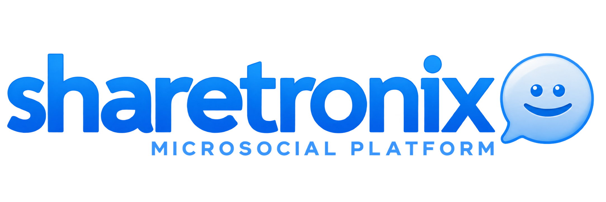

A maintained fork of Sharetronix **3.6.2**, a PHP platform for microblogging and social networking.

See the [changelog](CHANGELOG.md) for release history and the [maintenance roadmap](ROADMAP.md) for planned work.

## Source layout

- `index.php`, `.htaccess`, `web.config` — application entry point and server configuration.
- `system/` — application code, libraries, and languages.
- `themes/`, `static/` — templates, styles, scripts, and images.
- `install/` — installation and upgrade wizard.
- `apps/`, `storage/` — extensions and application storage.

## Getting started

```sh
git clone https://github.com/belomaxorka/sharetronix.git
cd sharetronix
```

The legacy codebase lists Apache, PHP 5.2+, and MySQL 5.0+ as historical requirements. Fresh installation, current-version updates, and core scenarios have now been verified on PHP **8.4.19**, Apache **2.4.66**, and MySQL **5.7.44** on Windows; see the [PHP 8.4 verification report](docs/test-runs/2026-10-18-php84.md) for the tested scope and remaining limits. Compatibility with newer databases and untested integrations remains separate work.

1. Configure an Apache virtual host for the checkout and enable `mod_rewrite`.
2. Create an empty MySQL database.
3. Open `/install/` on that virtual host and follow the installation wizard.

The installer creates `system/conf_main.php`. This installation-specific configuration, caches, and uploaded files are excluded from Git.

A Windows diagnostic stack is available in the [local development guide](docs/LOCAL_DEVELOPMENT.md). It provides isolated Apache/PHP/MySQL processes, captured email, and repeatable HTTP smoke checks. See the [baseline test report](docs/test-runs/2026-10-18-baseline.md) for verified scenarios and known defects, and the [testing guide](docs/TESTING.md) for broader coverage.

## Contributing

Read [CONTRIBUTING.md](CONTRIBUTING.md) for the workflow, Conventional Commits, and verification requirements. Follow existing code conventions, keep changes focused, and preserve author credits and third-party notices. Coding agents must also follow [AGENTS.md](AGENTS.md).

Original contributor credits remain in the source files.

## License

Sharetronix is licensed under the [GNU Affero General Public License, version 3](LICENSE.txt) (`AGPL-3.0-only`). Third-party components retain their respective licenses and copyright notices.
